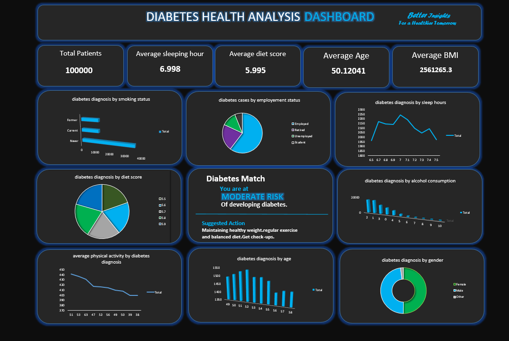

# diabetes dataset

## objective:
Main objective is to analyze diabetes data and identify patterns related to age, gender, BMI, lifestyle factors, and employment status.
This project helps visualize important findings through an interactive dashboard and provides insights that support diabetes awareness and preventive healthcare.

## Dataset Information:
The dataset contains 100,000 patient records related to diabetes health analysis. 
It includes information about age, gender, BMI, smoking status, employment status, sleep hours, diet score, alcohol consumption, and physical activity. 
This dataset helps analyze diabetes patterns and understand how different demographic and lifestyle factors are associated with diabetes.

## Dashboard features:
The dashboard provides interactive visualization for:
It analyze diabetes cases based on age, gender, smoking status, employment status, sleep hours, diet score, alcohol consumption, and physical activity.
It also displays key statistics such as total patients, diabetes rate, average age, and understand patterns in the dataset and identify areas for further analysis.

## Excel functions Used:
. COUNT/ COUNTROWS: To calculate the total number of patient records.
. COUNTIF/ CALCULATE: To calculate the number of diabetes cases based on specific condition.
. AVERAGE: To calcualte the average age and BMI of patients.
. DIVIDE: To calculate the diabetes rete as a percentage .
. IF: To display diabetes risk categories based on specific conditions.

## Tools & Technologies
Microsoft Excel, Pivot Tables, Charts, and Dashboard.

## Key Insights
The dashboard shows patterns in diabetes cases based on age, age, gender, BMI, and lifestyle factors.
It helps identify trends in the data and supports diabetes awareness and preventive healthcare.

